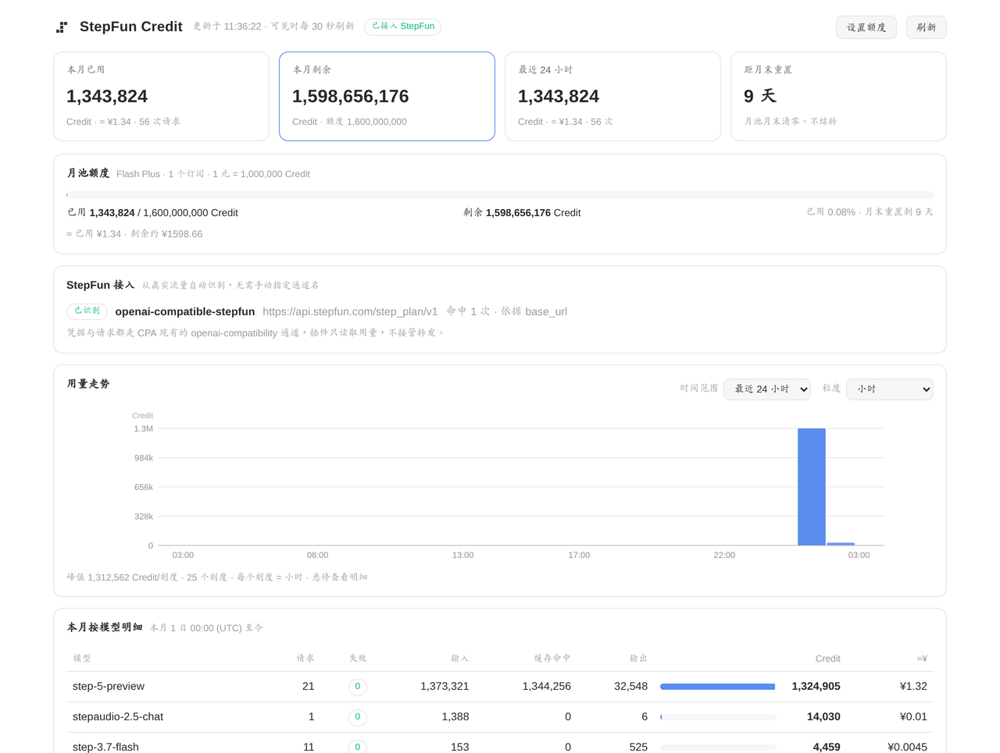
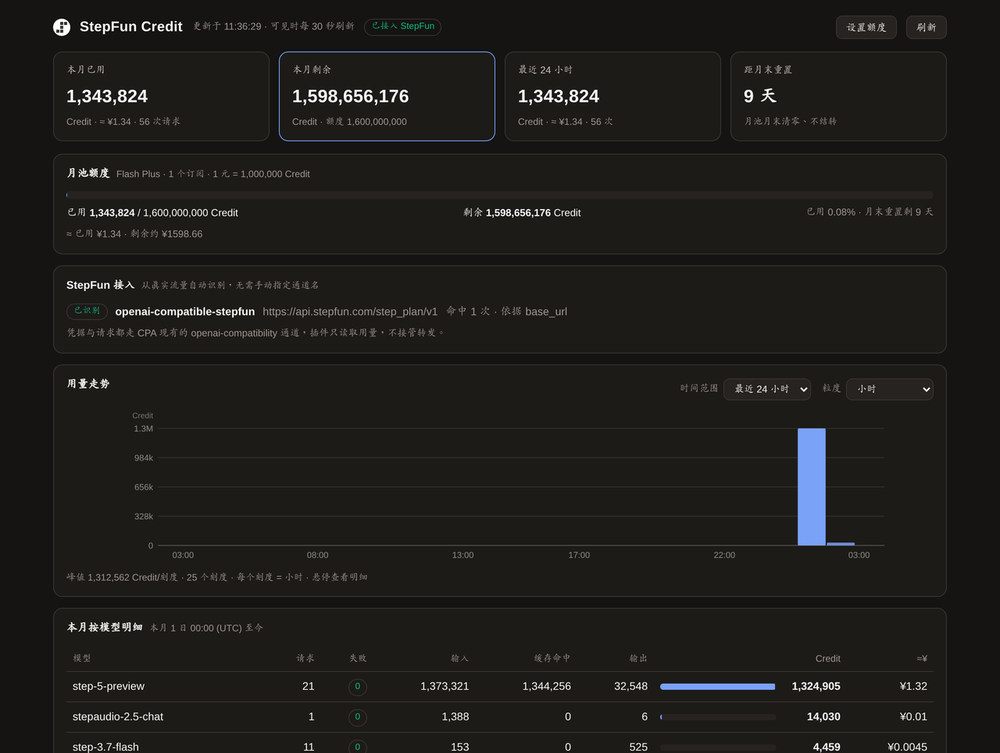
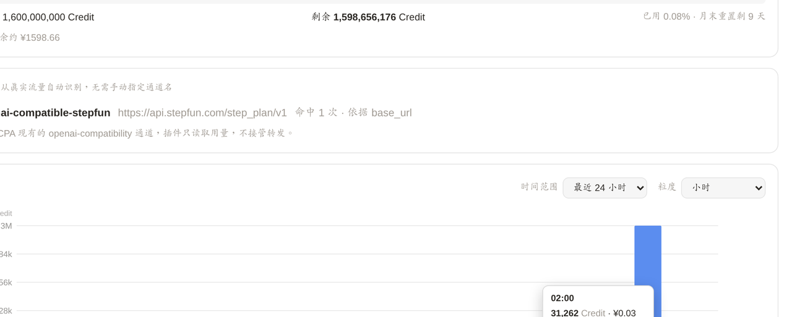
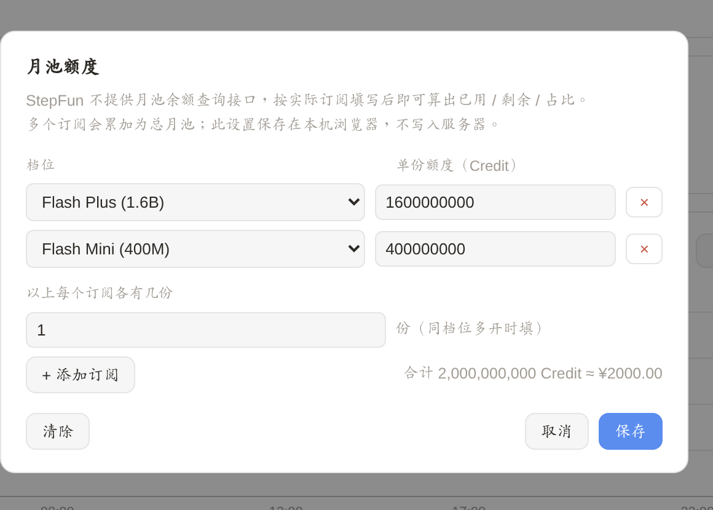

# CPA StepFun Credit Tracker

CLIProxyAPI 插件：实时统计 **StepFun Step Plan**（现行套餐 Token Plan，Credit 月池）的 Credit 消耗。

StepFun 官方没有开放订阅月池的查询接口，所以这个插件在 CPA 侧按每个请求的真实 token 用量、
结合官方单价折算 Credit，让你随时知道这个月花了多少、还剩多少。



## 功能

- 每次请求完成后实时记账（输入 / 缓存命中 / 输出 token、延迟、成败）
- 左侧菜单新增「StepFun Credit」页面，随 CPAMC 主题自动切换深浅色
- 时间范围（1 小时 ~ 全部）与粒度（分钟 / 小时 / 日 / 周 / 月）可切换
- 鼠标悬停查看单点明细（Credit、金额、请求数、失败数、输入输出）
- 支持登记多个订阅（各自档位或自定义额度），自动累加为总月池，显示已用 / 剩余 / 占比
- 内置 StepFun 官方单价；接入方式自动识别，无需手动配置 provider 名
- 免密查看：首次输入一次管理密钥换取只读令牌，之后打开页面直接看数据，不再每次输密码

## 截图

深色主题（跟随 CPAMC）：



悬停查看单个时间点的明细：



月池额度设置，支持多个订阅（不同档位可分别填写）：



## 支持的平台

提供 `linux_amd64`、`linux_arm64`、`windows_amd64` 三种预编译产物。

## 安装

从 Releases 下载对应平台的 zip，解压后把动态库放进 CPA 的插件目录：

```text
plugins/linux/amd64/stepfun-credit-tracker.so
```

然后在 `config.yaml` 里启用：

```yaml
plugins:
  enabled: true
  configs:
    stepfun-credit-tracker:
      enabled: true
```

重启或热加载 CPA 后，左侧菜单会出现「StepFun Credit」。

## 前提

CPA 里已经通过 `openai-compatibility` 接入了 StepFun，例如：

```yaml
openai-compatibility:
  - name: stepfun
    base-url: https://api.stepfun.com/step_plan/v1
    api-key-entries:
      - api-key: <你的 StepFun API Key>
    models:
      - name: step-3.7-flash
      - name: step-5-preview
```

插件会从真实请求里自动识别 StepFun 接入（按 `base-url` 与模型名前缀），不需要额外配置。
若尚未检测到，插件页会直接给出上面这段可复制的配置。

## 关于额度

月池总额度需要你自己填（StepFun 不提供查询接口）：打开插件页右上角「设置额度」，
按实际订阅选档位即可。下拉框内置官方四个档位（Flash Mini 400M / Flash Plus 1600M /
Flash Pro 8000M / Flash Max 40000M）与两个加油包（小 400M / 大 1600M，独立 30 天周期），
也可以填自定义数值。有多个订阅就逐个添加，会自动累加。此设置保存在浏览器本地。

## 查看权限（免密查看）

CPA 对 `/v0/management/*` 的门禁是**无状态** Bearer 校验：每次请求都要带管理密钥，
没有会话、没有 Cookie，插件也无法按路由绕过。因此从 v1.5.0 起读数据改走免鉴权的
资源路径 `/v0/resource/plugins/stepfun-credit-tracker/data/*`（仅 GET），但不是完全公开——
由插件颁发一个**只读令牌**：

- **首次进入**输入一次管理密钥，插件校验后颁发令牌（令牌由 CPA 管理密钥保护的路由发放），
  存入浏览器 localStorage；之后打开本页直接查看用量，**不再需要密钥**；
- 管理密钥本身不落浏览器盘：换到令牌后仅保留在 sessionStorage（当前标签页），关闭即失效；
- 只读令牌**只能看、不能改**：保存单价 / 保存额度 / 清空记录等写操作仍在
  `/v0/management/*` 后面，由 CPA 管理密钥把守；涉及 API Key 的操作在 CPA 管理后台；
- 令牌 256bit 随机，持久化在 CPA 数据目录（`stepfun-credit-read-token.json`，0600）；
  删除该文件即重新生成，浏览器端会在下次读取 401 后自动回到一次性密钥门禁。
- 浏览器存储被禁用/嵌入环境不可用时（localStorage 抛异常），令牌退化为仅当前页面
  有效（内存持有），页面会给出提示；也可用 `?token=<只读令牌>` 拼网址打开，
  完全不依赖浏览器存储。没有凭据时页面不会自动发请求，避免无密钥 401 累积
  CPA 的防爆破计数（同 IP 5 次失败封 30 分钟）。

## 说明

- Credit 折算口径：`1 元 = 1,000,000 Credit`
- 记账发生在 CPA 侧，是精确的 token 折算值；官方月池余额仍以 StepFun 控制台为准
- 插件不保存 prompt、请求正文或响应正文
- **安全**：数据展示走只读令牌（免管理密钥、只读）；写操作与令牌兑换走 CPA 管理密钥；
  密钥仅存于浏览器 sessionStorage，关闭标签页即失效

## 许可

MIT